<div align="center">

# 🔥 Last Ember

**소울라이크 3D 액션 · 개인 프로젝트**

*소울라이크 특유의 **정밀한 조작감**을 재현해보자!*

[](https://unity.com/)
[](#)
[](#)
[](#)

[▶ 포트폴리오 영상 (YouTube)](https://www.youtube.com/watch?v=uUuw1t44cd4)

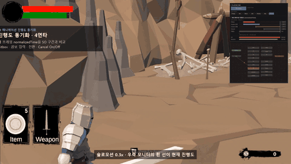 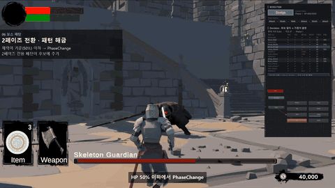

<sub>왼쪽: normalizedTime 기반 4연타 콤보 · 오른쪽: 보스 체력 50% 이하에서 2페이즈 전환 · 패턴 해금</sub>

</div>

<br>

## 📌 프로젝트 개요

| 항목 | 내용 |
| --- | --- |
| **장르** | 소울라이크 3D 액션 |
| **개발 형태** | 개인 프로젝트 (1인) |
| **맡은 역할** | 메인 개발, 메인 기획 |
| **개발 기간** | 2026.04.10 – 2026.04.29 (약 3주) |
| **개발 환경** | Unity 6 (6000.3.10f1), C#, URP, Input System |
| **참고 게임** | 다크소울 시리즈 |
| **목표** | 1인 개발 프로세스 숙달 · FSM 구조 이해 · FBX 리소스와 애니메이션 활용 숙달 |

<br>

## 🎮 게임 소개

> 화톳불을 거점으로 몬스터를 처치하며 성장하고, 보스 **Skeleton Guardian**을 쓰러뜨리는 소울라이크 액션입니다.

- **전투** — 무기별 연속 공격 · 선입력 · 공격 캔슬, 무적 구간이 있는 구르기와 대시, 타겟 락온
- **적 · 보스** — 감지 범위 · 시야각 기반으로 추적하는 일반 몬스터, 가중치 랜덤으로 패턴을 고르고 체력 50%에서 2페이즈로 전환하는 보스
- **성장 · 거점** — 아이템 획득, 장비 장착(무기 · 방어구 · 장신구 · 소모품), 화톳불 휴식과 레벨업, 사망 시 화톳불 부활 · 월드 리셋
- **입력** — 패드와 키보드 · 마우스 모두 대응

<br>

## 🙋 핵심 구현 요약

| # | 구현 내용 | 핵심 키워드 |
| :-: | --- | --- |
| 1 | [애니메이션 진행도 동기화](#1-애니메이션-진행도-동기화) | `normalizedTime`으로 판정 · 콤보 · 캔슬 · 무적 구간 제어 · 타임라인 커스텀 인스펙터 |
| 2 | [FSM 기반 상태 관리](#2-fsm-기반-상태-관리) | Player · Enemy · Boss가 공유하는 Controller → StateMachine → BaseState 골격 |
| 3 | [보스 전용 AI — Decision State](#3-보스-전용-ai--decision-state) | 거리 · 쿨타임 · 페이즈 필터 → 가중치 룰렛 → 허브 구조 |
| 4 | [데이터 주도 설계](#4-데이터-주도-설계--scriptableobject) | ScriptableObject로 밸런스 값과 로직 분리 · 무기 교체 = SO 교체 |

<br>

<p align="center">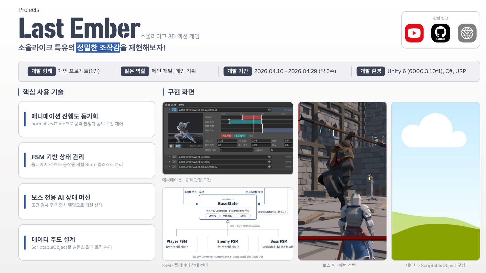</p>

---

## 1. 애니메이션 진행도 동기화

> **`normalizedTime`으로 공격 판정과 콤보 구간을 제어하고, 구간 값은 커스텀 인스펙터에서 타임라인으로 조절**

<table>
<tr>
<td width="50%">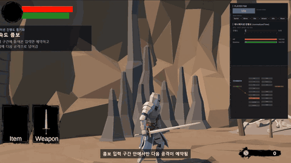</td>
<td width="50%">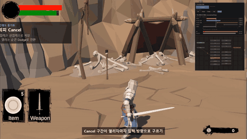</td>
</tr>
<tr>
<td align="center"><sub>콤보 입력 구간 안에서 다음 공격을 예약 (선입력)</sub></td>
<td align="center"><sub>Cancel 구간이 열리면 입력 방향으로 구르기</sub></td>
</tr>
<tr>
<td width="50%">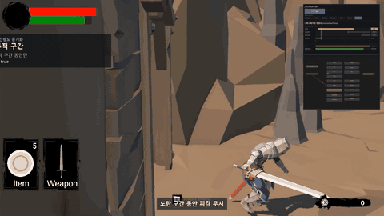</td>
<td width="50%">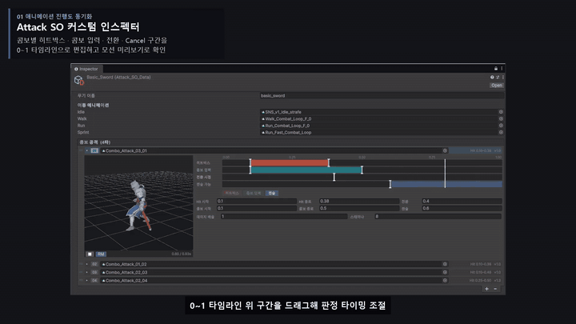</td>
</tr>
<tr>
<td align="center"><sub>노란 무적 구간 동안 피격 무시</sub></td>
<td align="center"><sub>0~1 타임라인 위 구간을 드래그해 판정 타이밍 조절</sub></td>
</tr>
</table>

| 설계 | 내용 |
| --- | --- |
| **매 프레임 진행도 조회** | `Update`에서 현재 애니메이션 클립의 `normalizedTime`을 0~1로 직접 읽음 |
| **SO의 구간 값과 비교** | 판정 · 콤보 · Cancel · 무적 구간을 진행도 범위로 On/Off |
| **전환 중에는 판정 보류** | `IsInTransition` · State 해시가 맞을 때만 구간 적용 |
| **커스텀 인스펙터** | 공격 · 구르기 · 보스 패턴 SO에 구간 타임라인, 모션 미리보기, 개별 값 조절 필드를 한 화면에 배치 |

```csharp
// AttackState.cs — 진행도를 SO에 정의된 구간과 비교
AnimatorStateInfo stateInfo = player.animator.GetCurrentAnimatorStateInfo(0);
float progress = stateInfo.normalizedTime;                    // 0 ~ 1
AttackData currentAttackData = player.currentWeapon.comboAttacks[comboIndex];

bool isPlayingAttack = stateInfo.shortNameHash == expectedHash;
if (isPlayingAttack && !player.animator.IsInTransition(0))   // 전환 중에는 보류
{
    player.canCombo      = progress >= currentAttackData.comboWindowStart
                        && progress <= currentAttackData.comboWindowEnd;
    player.canNextAttack = progress >= currentAttackData.comboTransitionPoint;
    player.canCancel     = progress >= currentAttackData.cancelWindowStart;
}
```

<details>
<summary>📑 포트폴리오 슬라이드 보기 (애니메이션 진행도 동기화 · 커스텀 인스펙터)</summary>
<br>
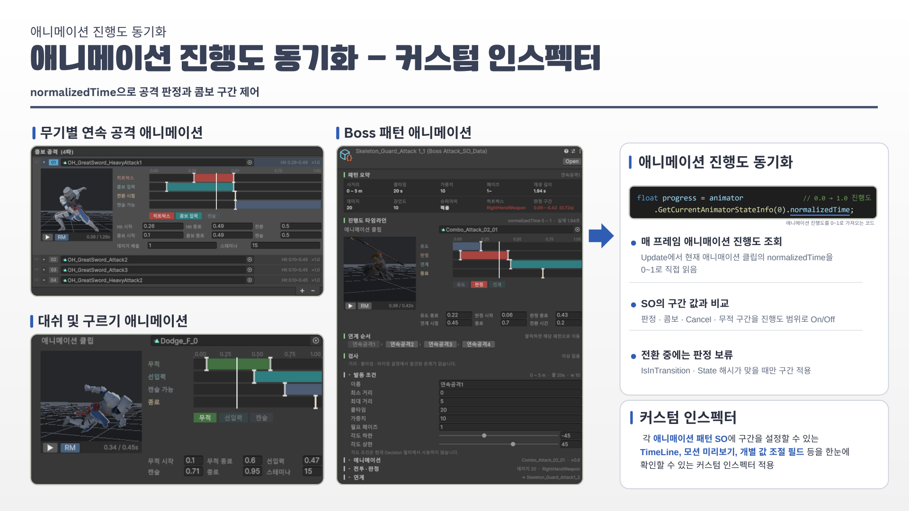
</details>

📂 **관련 코드** — [`AttackState.cs`](Assets/Scripts/Player/Controller_and_State/AttackState.cs) · [`DodgeState.cs`](Assets/Scripts/Player/Controller_and_State/DodgeState.cs) · [`Attack_SO_DataEditor.cs`](Assets/Editor/SO_Timeline/Attack_SO_DataEditor.cs) · [`TimelineGUI.cs`](Assets/Editor/SO_Timeline/TimelineGUI.cs) · [`ClipPosePreview.cs`](Assets/Editor/SO_Timeline/ClipPosePreview.cs)

---

## 2. FSM 기반 상태 관리

> **Controller가 State를 만들고, StateMachine이 현재 State 하나만 실행하는 공통 골격 위에서 FSM마다 전환 기준만 다르게 설계**

### 공통 구조

```
Controller (MonoBehaviour)  ── Awake에서 모든 State를 한 번만 생성, 매 프레임 실행은 위임
   └─ StateMachine (순수 C#) ── 현재 State 하나만 실행, 교체 시 Exit → Enter 순서 보장
        └─ BaseState (abstract) ── Enter · Update · Exit 중 필요한 메서드만 override
             ├─ Player FSM  : 입력이 다음 상태를 결정
             ├─ Enemy FSM   : 거리가 다음 상태를 결정
             └─ Boss FSM    : Decision이 다음 행동을 결정
```

**FSM을 적용한 이유**
- **겹치면 안 되는 행동 분리** — 공격 · 구르기 · 피격이 겹치지 않도록 한 번에 State 하나만 실행
- **같은 입력, 상태별로 다른 반응** — 공격 입력도 Idle은 공격 시작, Attack은 콤보 예약, Hit · Dead는 무시
- **적은 확장 비용** — 새 행동은 State 클래스 하나만 추가, 기존 State 코드는 수정하지 않음

<table>
<tr>
<td width="50%">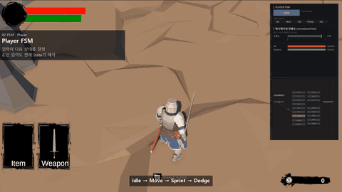</td>
<td width="50%">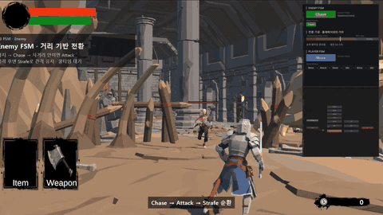</td>
</tr>
<tr>
<td align="center"><sub>Player FSM — Idle → Move → Sprint → Dodge</sub></td>
<td align="center"><sub>Enemy FSM — Chase → Attack → Strafe 순환</sub></td>
</tr>
</table>

| FSM | 전환 기준 | 설계 포인트 |
| --- | --- | --- |
| **Player** | 공격 · 구르기 · 포션 · 상호작용 입력 → 현재 State가 해석 | Controller는 입력을 현재 State에 전달만 함. 이동은 매 프레임 폴링, 공격 · 구르기는 `normalizedTime`으로 스스로 종료. 판정 · 콤보 · 무적 구간은 SO에 두어 무기를 바꿔도 State 코드는 그대로 |
| **Enemy** | 플레이어와의 거리 (3m 근접 · 10m 감지 · 15m 해제) | 반경 · 시야각 · 장애물 Raycast를 모두 통과해야 Chase. 공격이 끝나면 항상 Strafe로 빠져 쿨타임 동안 간격 유지. 패턴 SO마다 AttackState를 만들고 사거리 · 쿨타임을 통과한 패턴 중 가중치로 선택 |
| **Boss** | 거리 · 쿨타임 · 페이즈 필터 → 가중치 룰렛 | 모든 행동 State는 끝나면 Decision으로 복귀 (State끼리 직접 전환 없음). → [3. Decision State](#3-보스-전용-ai--decision-state) |

<p align="center">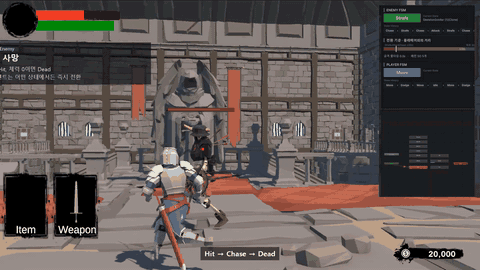<br><sub>피격 · 사망 — Hit → Chase → Dead</sub></p>

<details>
<summary>📑 포트폴리오 슬라이드 보기 (FSM 공통 구조 · Player · Enemy · Boss FSM)</summary>
<br>
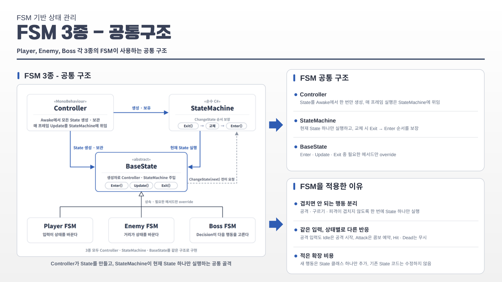
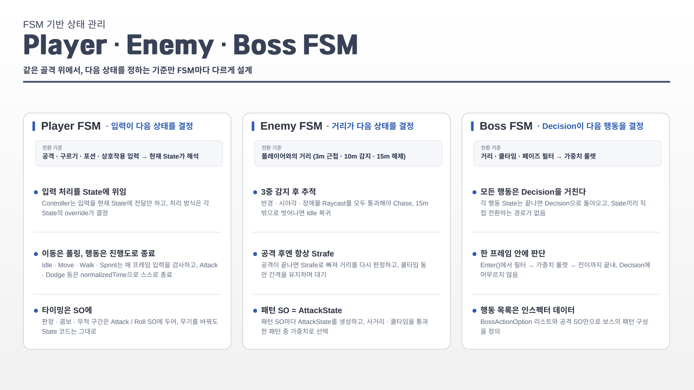
</details>

📂 **관련 코드** — [`StateMachine.cs`](Assets/Scripts/Player/Controller_and_State/StateMachine.cs) · [`PlayerBaseState.cs`](Assets/Scripts/Player/Controller_and_State/PlayerBaseState.cs) · [`PlayerController.cs`](Assets/Scripts/Player/Controller_and_State/PlayerController.cs) · [`EnemyStateMachine.cs`](Assets/Scripts/Enemy/State/EnemyStateMachine.cs) · [`EnemyController.cs`](Assets/Scripts/Enemy/EnemyController.cs) · [`BossStateMachine.cs`](Assets/Scripts/Boss/State/BossStateMachine.cs)

---

## 3. 보스 전용 AI — Decision State

> **조건 검사 후 가중치 랜덤으로 패턴을 선택하고, 모든 행동이 Decision을 거쳐 결정되는 허브 구조**

<table>
<tr>
<td width="50%">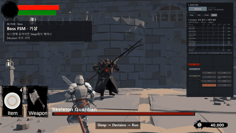</td>
<td width="50%">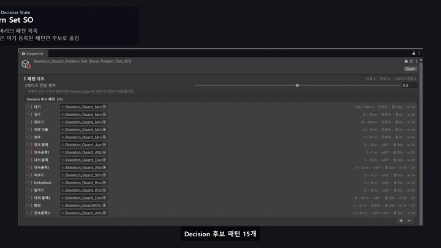</td>
</tr>
<tr>
<td align="center"><sub>거리에 따라 후보 패턴과 확률이 바뀜</sub></td>
<td align="center"><sub>거리 · 각도 · 페이즈를 바꾸면 후보와 확률이 바로 반영되는 시뮬레이터</sub></td>
</tr>
</table>

| 단계 | 동작 |
| :-: | --- |
| **01 후보 필터** | 거리(min ~ max) · 쿨타임 · 페이즈 중 하나라도 불만족하면 제외. 기준값은 패턴 SO에서 읽음 |
| **02 가중치 룰렛** | 남은 후보를 `baseWeight` 비율로 룰렛을 돌려 1개 추출 |
| **03 전이** | 공격 패턴이면 공격 SO를 Attack State에 주입하고, 패턴의 `StateType`으로 등록된 State로 전이 |
| **04 복귀 루프** | 각 State의 행동이 끝나면 Decision State로 복귀 |

- **한 프레임 안에 판단** — `Enter()`에서 필터 → 룰렛 → 전이까지 끝내 Decision에 머무르지 않음
- **행동 목록은 인스펙터 데이터** — `BossActionOption` 리스트와 공격 SO만으로 보스의 패턴 구성을 정의
- **페이즈 전환** — 체력 50% 이하에서 PhaseChange State를 거쳐 `requiredPhase`가 2인 패턴이 후보에 추가됨

```csharp
// Humanoid_Boss_DecisionState.cs — 후보 필터 → 가중치 룰렛
foreach (var option in boss.availableActions)
{
    if (distanceToPlayer < option.minDistance || distanceToPlayer > option.maxDistance) continue;
    if (Time.time < option.lastUsedTime + option.cooldown) continue;
    if (option.stateType == BossStateType.Attack && option.attackData != null
        && option.attackData.requiredPhase > boss.currentPhase) continue;   // 페이즈 판단

    validOptions.Add(option);
    totalWeight += option.baseWeight;
}

int randomValue = Random.Range(0, totalWeight);
int cumulativeWeight = 0;
foreach (var option in validOptions)
{
    cumulativeWeight += option.baseWeight;
    if (randomValue < cumulativeWeight) { option.lastUsedTime = Time.time; return option; }
}
```

<details>
<summary>📑 포트폴리오 슬라이드 보기 (보스 전용 AI 상태 머신)</summary>
<br>
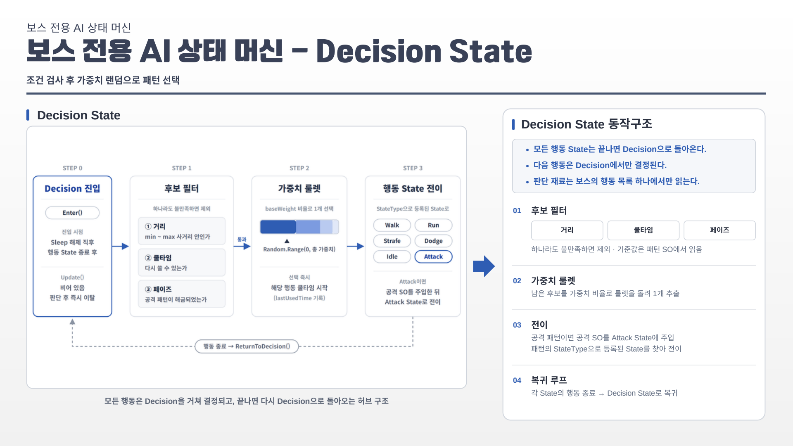
</details>

📂 **관련 코드** — [`Humanoid_Boss_DecisionState.cs`](Assets/Scripts/Boss/State/Humanoid_Boss_State/Humanoid_Boss_DecisionState.cs) · [`BossActionOption.cs`](Assets/Scripts/Boss/BossActionOption.cs) · [`BossBaseController.cs`](Assets/Scripts/Boss/State/BossBaseController.cs) · [`Humanoid_Boss_PhaseChange_State.cs`](Assets/Scripts/Boss/State/Humanoid_Boss_State/Humanoid_Boss_PhaseChange_State.cs) · [`BossActionOptionDrawer.cs`](Assets/Scripts/Editor/BossActionOptionDrawer.cs)

---

## 4. 데이터 주도 설계 — ScriptableObject

> **ScriptableObject로 밸런스 값과 로직을 분리 — 값은 SO, 규칙은 State**

<p align="center">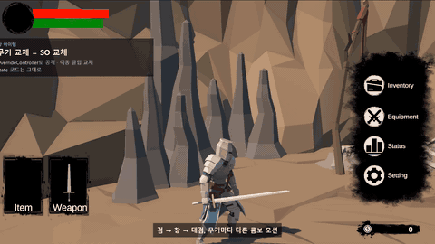<br><sub>검 → 창 → 대검 — 무기마다 다른 콤보 모션, State 코드는 그대로</sub></p>

| 구분 | 설계 | 내용 |
| --- | --- | --- |
| **패턴 · 모션 SO** | 값은 SO, 규칙은 State | 판정 · 콤보 · Cancel 구간은 SO에 두고, State는 매 프레임 읽기만 함 |
| | 무기 교체 = SO 교체 | 장착 시 `AnimatorOverrideController`로 공격 · 이동 클립만 바꾸고 State 코드는 그대로 |
| | 런타임 기록은 SO 밖에 | 쿨타임 기록은 State · 행동 목록에 두어 같은 SO를 여러 개체가 공유 |
| **아이템 SO** | 공통 필드는 `ItemDataBase` | ID · 이름 · 아이콘 · 등급 · 가격을 공유하고, 무기 · 방어구 · 장신구 · 소모품별로 필요한 필드만 추가 |
| | 원본과 소지 상태 분리 | SO는 공유 원본, 개수 · 강화 수치는 `ItemInstance`가 따로 보관 |
| | ID 기반 저장 대비 | 저장 대상은 `itemID`뿐, SO 참조는 `NonSerialized`로 저장에서 제외 |

```csharp
// PlayerController.cs — 무기 SO의 클립으로 애니메이터 덮어쓰기
public void EquipWeapon(Attack_SO_Data newData)
{
    Attack_SO_Data targetData = newData != null ? newData : defaultUnarmedData;
    currentWeapon = targetData;

    for (int i = 0; i < targetData.comboAttacks.Length; i++)
        overrideController[$"Attack{i + 1}"] = targetData.comboAttacks[i].clip;

    if (targetData.idleClip != null)   overrideController["Idle"]   = targetData.idleClip;
    if (targetData.walkClip != null)   overrideController["Walk"]   = targetData.walkClip;
    if (targetData.runClip != null)    overrideController["Run"]    = targetData.runClip;
    if (targetData.sprintClip != null) overrideController["Sprint"] = targetData.sprintClip;
    ...
}
```

<details>
<summary>📑 포트폴리오 슬라이드 보기 (데이터 주도 설계)</summary>
<br>
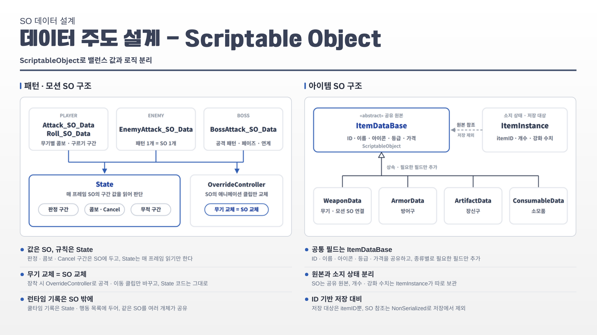
</details>

📂 **관련 코드** — [`Attack_SO_Data.cs`](Assets/Scripts/ScriptableObject/Attack_SO_Data.cs) · [`Roll_SO_Data.cs`](Assets/Scripts/ScriptableObject/Roll_SO_Data.cs) · [`BossAttack_SO_Data.cs`](Assets/Scripts/ScriptableObject/BossAttack_SO_Data.cs) · [`ItemDataBase.cs`](Assets/Scripts/ScriptableObject/Item/ItemDataBase.cs) · [`ItemInstance.cs`](Assets/Scripts/ScriptableObject/Item/ItemInstance.cs)

---

## ➕ 그 외 구현

<table>
<tr>
<td width="50%">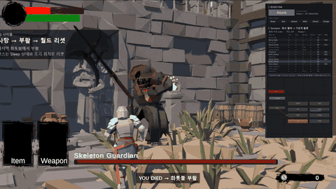</td>
<td width="50%">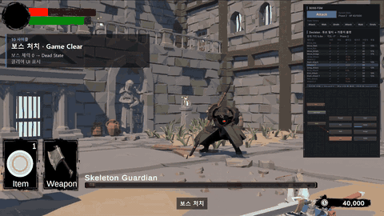</td>
</tr>
<tr>
<td align="center"><sub>사망 → 화톳불 부활 → 월드 리셋</sub></td>
<td align="center"><sub>보스 처치 → Game Clear</sub></td>
</tr>
</table>

- **화톳불** — 휴식 · 레벨업(스탯 분배) · 부활 거점 ([`BornFire.cs`](Assets/Scripts/GameManager/BornFire.cs), [`LevelUpUIManager.cs`](Assets/Scripts/UI/LevelUpUIManager.cs))
- **인벤토리 · 장비 · 퀵슬롯** — 무기 · 방어구 · 장신구 · 소모품 장착, 포션 사용(Drink State) ([`InventoryManager.cs`](Assets/Scripts/UI/Inventory/InventoryManager.cs), [`EquipmentManager.cs`](Assets/Scripts/UI/Equipment/EquipmentManager.cs))
- **히트박스 판정** — 무기 오브젝트의 히트박스를 공격 데이터의 활성 구간에 맞춰 On/Off ([`WeaponController.cs`](Assets/Scripts/Weapon/WeaponController.cs), [`BossHitboxManager.cs`](Assets/Scripts/Boss/BossHitboxManager.cs))
- **락온 카메라** ([`CameraController.cs`](Assets/Scripts/Camera/CameraController.cs), [`LockOnUI.cs`](Assets/Scripts/UI/PlayerUI/LockOnUI.cs))

---

## 💡 배운 점

이전에는 기능을 완성하는 데 집중했지만, 이 프로젝트에서 FSM과 ScriptableObject로 상태 관리와 데이터를 분리하며 **기능 추가와 수정을 고려한 구조의 중요성**을 배웠습니다.
이후 팀 프로젝트에서는 팀원이 코드를 수정하지 않고도 웨이브와 패턴을 조정할 수 있도록 데이터 구조와 커스텀 인스펙터를 설계하는 데 이 경험을 적용했습니다.

<br>

## 🧰 기술 스택

| 분류 | 사용 기술 |
| --- | --- |
| **Engine** | Unity 6 (6000.3.10f1), URP |
| **Language** | C# |
| **Input** | Unity Input System (게임패드 · 키보드/마우스) |
| **Animation** | Animator, AnimatorOverrideController, Root Motion |
| **Editor Tool** | Custom Inspector (SO 타임라인 · 모션 미리보기) |
| **Collaboration** | Git, GitHub |

<br>

<div align="center">

**최준영 · Unity Client Developer**
📧 juny2221@gmail.com · ▶ [YouTube](https://www.youtube.com/channel/UCMoIuWbEUPRG-8-CIZpd6cQ)

</div>
